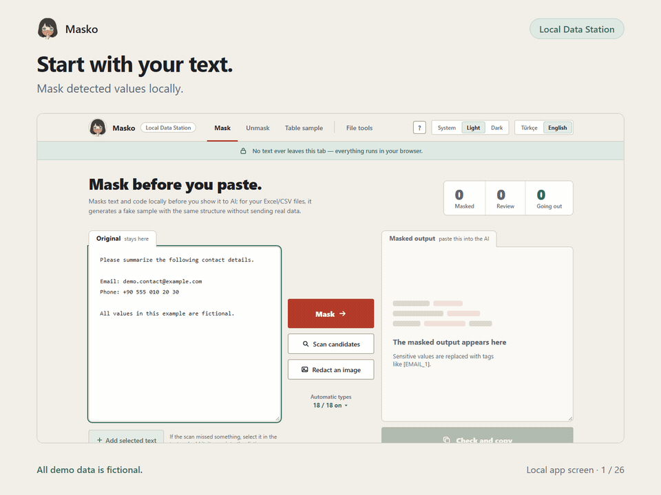

# Masko — Local Data Station

**Prepare data for AI and handle everyday file work in your browser.**

I started Masko because I wanted to use AI to explore and visualize data without sharing the original file. Masko helps prepare a synthetic sample from a table and brings common data and document tasks into a simple local interface.

**[Explore the 12 feature demos](https://aydangelenyolcu.github.io/masko-local-data-station/)**

## What you can do

- Mask sensitive values in text before you choose to share a prompt with ChatGPT, Claude, Gemini, or Google AI Studio. Restore placeholders locally when needed.
- Inspect a CSV or Excel table and create a synthetic sample and data passport to use when asking an AI to help analyze the data.
- Deduplicate lists using column-aware normalization and review or export the results. Large CSV files use a streaming read and export path; Excel workbook loading has separate memory limits.
- Split CSV files, compare tables, match similar names, reshape wide tables, repair text encoding, profile data, and run SQL locally.
- Organize and combine PDF files with local browser tools.

The product is still being developed. Performance depends on the file and computer. A recorded local Chrome run processed a 5-million-row CSV; that result describes one test setup, not a speed guarantee. The sample GIFs use fictional data.

## Install in Chrome

1. Download or clone this repository.
2. Open `chrome://extensions` and turn on **Developer mode**.
3. Choose **Load unpacked** and select the extracted repository folder containing `manifest.json`.
4. Pin the Masko icon if you want quick access from the toolbar.

The extension includes English and Turkish interfaces. Supported AI-site controls need access to ChatGPT, Claude, Gemini, and Google AI Studio pages. You can also use the local Masko page without enabling those site integrations.

## Privacy and limits

Masko has no application server. File processing and masking run locally in the browser. The extension requests access to supported AI chat pages so it can show its controls and protect paste flows. You remain in control of sending the resulting prompt; the AI service processes anything you choose to send under that service's terms.

See the [Masko Privacy Policy](https://aydangelenyolcu.github.io/masko-local-data-station/privacy.html) for details about locally processed content, extension storage, and your choices.

Reversible text masking is pseudonymization, not anonymization. Review generated samples and masked text before sharing. Masko cannot protect text typed manually into an AI chat box character by character.

## Source and license

This repository contains the production extension files, English and Turkish interface resources, local demo gallery, and the included third-party notices. See [LICENSE](LICENSE) for the project license.

---

**Türkçe:** Masko, yapay zekâyla veri analizi yaparken gerçek dosyayı paylaşma kaygısıyla başladı. Tablo yapısından sentetik örnek hazırlamaya ve günlük dosya işlerini tarayıcıda yapmaya yardımcı olur. Arayüz Türkçe ve İngilizcedir. Maskeleme geri açılabildiği için anonimleştirme sayılmaz; paylaşmadan önce çıktıları kontrol edin.
